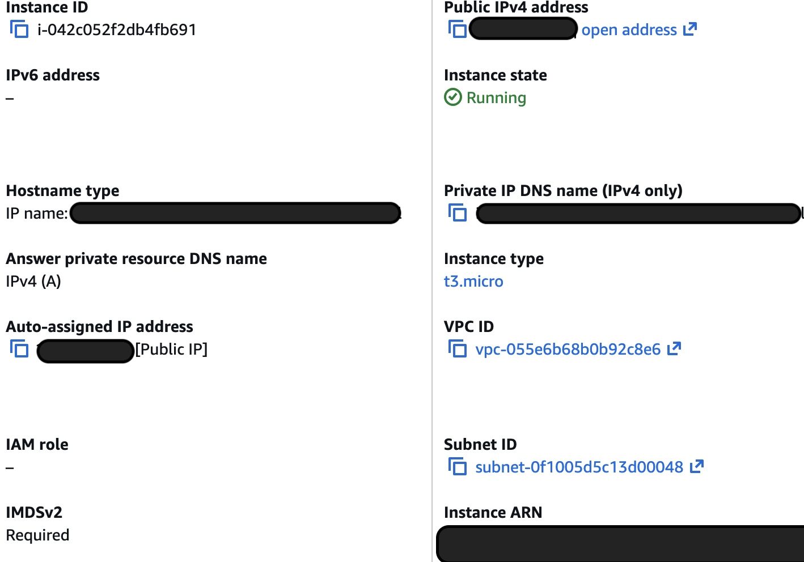
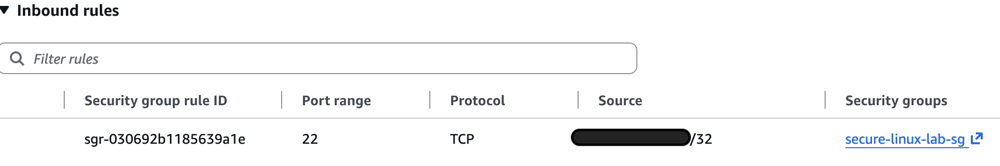

## AWS EC2 Linux Server Deployment

An Ubuntu Linux server was deployed using Amazon EC2 to provide
the base environment for the security monitoring lab.

### EC2 Configuration

- **Operating System:** Ubuntu Server 26.04 LTS (HVM)
- **AMI:** ami-0e5497a77ef21b5ac
- **Architecture:** x86-64
- **Instance Type:** t3.micro
- **AWS Region:** us-east-2
- **Storage:** 8 GiB EBS General Purpose SSD (gp3)
- **Authentication:** SSH public-key authentication
- **SSH Port:** TCP 22
- **SSH Source:** Restricted to administrator public IP (/32)

### Security Considerations

SSH access was restricted at the AWS Security Group level to
the administrator's public IP address rather than allowing
connections from `0.0.0.0/0`.

Public-key authentication was used for remote administrative
access. The EC2 private key is stored locally outside the Git
repository, and private key file types are excluded through
`.gitignore`.

### Evidence

#### EC2 Instance



#### Security Group



## SSH Server Hardening

- Reviewed the effective OpenSSH configuration
- Backed up the existing configuration before modification
- Disabled password-based SSH authentication
- Disabled direct root SSH login
- Explicitly retained public-key authentication
- Validated the configuration before reloading SSH
- Verified key-based access from a second SSH session
- Tested that password authentication and root login were rejected

```text
PasswordAuthentication no
```

If SSH accepts passwords, an attacker can repeatedly try username/password combinations against the server. Disabling password authentication removes that login method, so knowing or guessing the account's password isn't enough to SSH into the server. The server instead relies on possession of the appropriate private key.

```text
PermitRootLogin no
```

`root` has essentially unrestricted administrative control over a Linux system. Disabling direct root SSH login means someone cannot remotely authenticate directly as `root`. I instead log in using a normal account such as `ubuntu` and elevate privileges with `sudo` when necessary.

```text
PubkeyAuthentication yes
```

The EC2 server accepts SSH public-key authentication. The server has the authorized public key, while you keep the corresponding private `.pem` key on your computer. When you connect, SSH uses cryptography to prove you possess the private key without transmitting the private key to the server.

This setup changes remote administration from:

```text
Internet
   ↓
SSH
   ↓
Username + password  ❌
Direct root login    ❌
```

to:

```text
Authorized IP (/32)
        ↓
     TCP 22
        ↓
       SSH
        ↓
Public-key authentication  ✅
        ↓
   ubuntu account
        ↓
  sudo when needed
```

## AWS Security Group Hardening

1. Least priveledge
Least privilege means allowing only the access necessary to perform a task and nothing more.

For the EC2 server, SSH is needed for remote administration, so I allow:
`TCP 22`

But instead of allowing the entire internet:
`0.0.0.0/0   ❌`

I restrict it to:

`Administrator's public IP/32   ✅`

A /32 represents one IPv4 address. Therefore, I am not exposing SSH to every internet address when only my administrative connection needs access.

2. Network-level control
My AWS Security Group is the network-level control.

Traffic effectively encounters this control before it can reach SSH on my EC2 instance:
```text
Internet
   ↓
AWS Security Group
   ↓
Is TCP 22 permitted from this source IP?
   ↓
EC2 instance
```

If someone connects from an IP that isn't permitted by the Security Group, the SSH service doesn't get an allowed inbound connection through that rule.

The rule therefore provides a network-layer restriction:
```text
SSH
TCP
22
[ADMIN-IP]/32
```
3. Host-level control
Once permitted traffic reaches the EC2 instance, OpenSSH (sshd) provides another layer of controls on the Linux host.

That's where the settings I configured matter:
```text
PasswordAuthentication no
PermitRootLogin no
PubkeyAuthentication yes
```

So even an SSH connection permitted through the Security Group still has to satisfy the SSH authentication policy.

### Defense in Depth

The server uses multiple layers of security rather than relying on a single control. At the network level, the AWS Security Group permits SSH traffic on TCP port 22 only from the administrator's authorized public IP address using a `/32` CIDR restriction.

At the host level, OpenSSH is hardened by disabling password authentication and direct `root` login while retaining public-key authentication. Together, these controls reduce unnecessary network exposure and strengthen authentication for remote administrative access.

### Security Group Evidence

